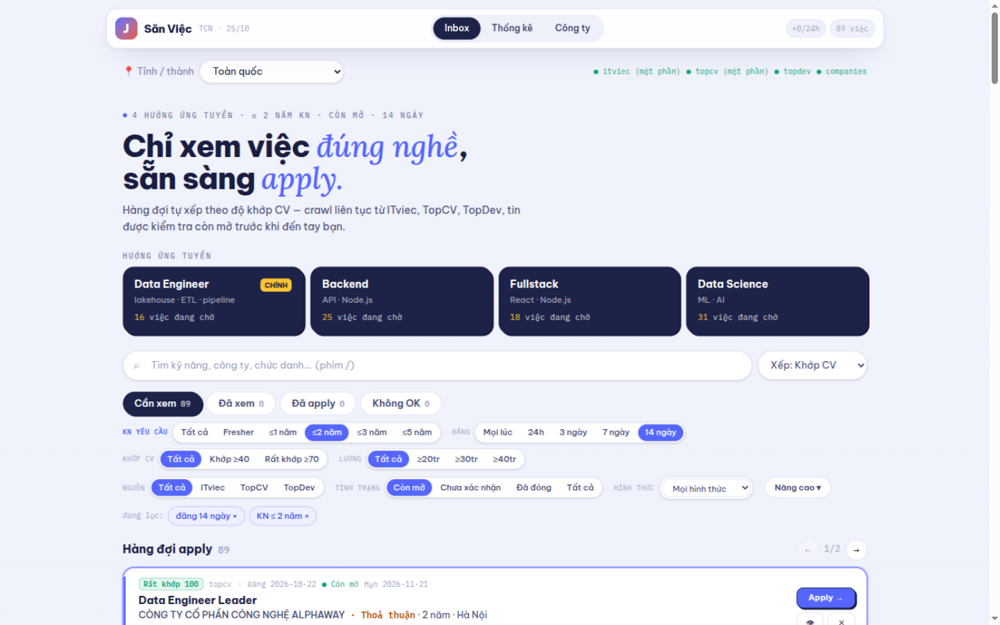

<div align="center">

# Săn Việc

**A private job-intelligence pipeline for the Vietnamese IT market.**

Crawls three job boards every 15 minutes, scores every posting against my CV,
maintains a 65k+ company directory, and serves it as a personal web app.

[](https://github.com/huy-dataguy/job-crawler/actions/workflows/ci.yml)


<br/>



<br/>

**[Live app](https://job-crawler-theta.vercel.app)** (private, Google auth) ·
**[Vận hành tiếng Việt](docs/operations.md)**

</div>

## Why

Job postings for Data Engineering / Backend / Fullstack / Data Science roles are
scattered across three Vietnamese boards, mixed with irrelevant roles and
senior-only requirements. Scrolling them manually every day doesn't scale.

This project turns that into an automated feed: a crawler fetches listings
every 15 minutes, normalizes them into one schema, scores each job 0–100
against my profile (skills, target roles, experience ceiling), verifies listings
are still open, and exposes everything through a private web app with an
apply-first inbox.

## Features

- **Match-scored inbox** — every job scored 0–100 against my CV (skill weights ×
  title/category factors); defaults to my four target roles and a ≤2-year
  experience ceiling.
- **Open-state verification** — listings are re-checked against the source
  page (posted date, expiry, 404) so dead postings don't waste apply clicks.
- **Company directory** — 65k+ profiles harvested from public sitemaps,
  enriched hourly (size, industry, tech stack, benefits), browsable as "who is
  hiring" cards with open roles per company.
- **Keyboard-first inbox** — `j/k` navigate, `a` apply, `s` star, `v` viewed,
  `x` hide; filters, open job details and scroll position live in the URL.
- **Stats under the same filters** — trends, experience distribution, salary
  bands; every KPI respects the active filter set.
- **Private by default** — production is locked to a single Google account.

## Architecture

```text
personal machine (data plane)                 cloud (serving plane)
┌────────────────────────────────┐            ┌─────────────────────────┐
│ Windmill orchestration         │            │ Supabase Postgres       │
│  crawl :00/:15/..  (quick)     │   sync     │  RLS-enforced           │
│  deep  04:37       (full sweep)│ ────────►  │                         │
│  enrich :20 hourly             │  precomp:  │ Vercel                  │
│  sync  :10/:25/..              │  arrays +  │  static React SPA       │
│ SQLite (WAL, FTS5)             │  GIN idx   │  FastAPI serverless     │
│ raw evidence: sha256+gzip,48h  │            └────────────┬────────────┘
└────────────────────────────────┘                         ▼
                                    job-crawler-theta.vercel.app
```

The two planes are independent: job data flows only through the sync job
(every 15 min), code changes deploy through Git. One person operates both.

## Tech stack

React 19 · TypeScript · Vite · Tailwind CSS v4 · TanStack Query · React Router ·
Recharts · FastAPI · SQLite (WAL, FTS5) · PostgreSQL (Supabase, RLS) ·
psycopg2 · curl_cffi (TLS impersonation, no headless browser) · BeautifulSoup ·
Windmill · Vercel · uv · pytest

## Getting started

Prerequisites: Python 3.11+, [uv](https://docs.astral.sh/uv/), Node.js 18+,
Docker (for Windmill).

```bash
git clone https://github.com/huy-dataguy/job-crawler.git && cd job-crawler

uv sync --extra dev                                   # backend deps
npm --prefix frontend ci && npm --prefix frontend run build
uv run job-crawler migrate                            # schema (auto-backup if DB exists)
uv run job-crawler all                                # first crawl
scripts/local/windmill.sh up                          # scheduler + UI at localhost:8132
```

Dashboard runs at `localhost:8130`, Windmill UI at `localhost:8132`
(`admin@windmill.dev` / `changeme`). Containers restart with the machine —
no manual steps after reboot.

## Operations

```bash
scripts/local/check.sh            # health across 7 layers (scheduler → crawl → sync → cloud)
scripts/local/windmill.sh runs    # last 10 pipeline runs
uv run job-crawler raw-gc         # prune raw evidence manually
uv run pytest -q                  # 60 tests
```

Configuration lives in `.env` — full reference, schedules, storage capacity
and troubleshooting in [docs/operations.md](docs/operations.md).

## Deployment

Production runs on Vercel (SPA + FastAPI serverless) with Supabase Postgres
behind row-level security. `scripts/local/deploy_vercel.sh` deploys manually;
connecting the GitHub repo in Vercel enables deploy-on-push. Initial setup
(Google OAuth, provider, RLS) is documented in
[docs/security.md](docs/security.md).

## Notable engineering

- **No headless browser** — all three boards are scraped over HTTP with TLS
  fingerprint impersonation; TopDev's React Server Components are parsed by
  streaming JSON extraction after their stack migration.
- **SQLite → Postgres without changing the API contract** — hard-to-port Python
  logic (accent-insensitive province matching, role matching, open-state rules)
  is precomputed into array columns with GIN indexes at sync time, so the
  serverless API filters by index only.
- **Query optimization** — replaced correlated subqueries scanning a 65k-row
  directory per row: jobs endpoint 74s → 0.3s, companies 21.7s → 0.2s.
- **Raw evidence with lifecycle** — content-addressed, gzip-compressed,
  TTL-pruned after ingestion: from +7.4 GB/day unbounded to a ~2 GB steady state.

## License

[MIT](LICENSE) © Nguyen Quoc Huy
